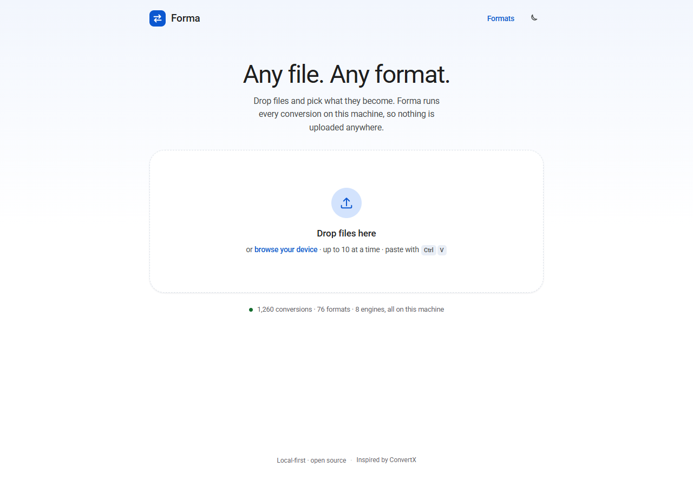
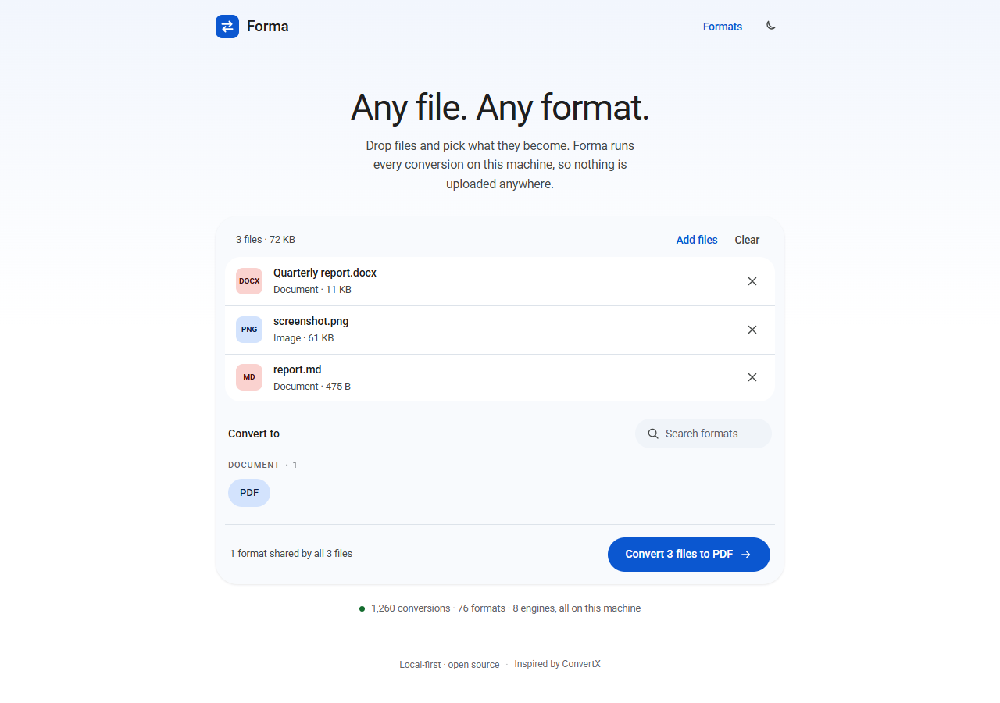
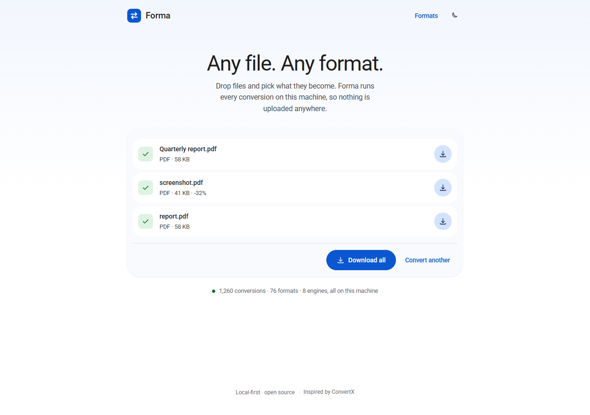

# Forma

**Any file. Any format.** A local, single-screen file converter: drop files, pick what they
become, download the results. Nothing is uploaded anywhere.



Forma is a working implementation of the "convert anything" idea, built on top of
[C4illin/ConvertX](https://github.com/C4illin/ConvertX) (19k★) — the open-source project that
documents and wires up the widest set of file-conversion engines (FFmpeg, LibreOffice, Pandoc,
ImageMagick, Calibre, MuPDF, and more). Forma borrows that idea and its engine-per-format model,
then narrows it down to seven bundled engines and one focused screen.

---

## Quick start

```bash
npm install
npm run setup   # downloads portable Pandoc (one time, ~41 MB)
npm start
```

Open **http://127.0.0.1:4173**.

Requirements: Node 20+. FFmpeg and Chrome/Edge are used when present. `npm run setup` fetches the
Pandoc build document conversion needs; it is skipped when Pandoc is already on your PATH. Without
it everything except document/e-book/slide conversion still works.

```
  Forma — any file, any format
  ──────────────────────────────────────────────
  engines    libvips, pdf-lib, SheetJS, OOXML reader, MuPDF, Pandoc, Chromium, FFmpeg
  inactive   LibreOffice
  catalog    87 formats
  matrix     1,260 conversions across 76 source formats
  ──────────────────────────────────────────────
  ready at http://127.0.0.1:4173
```

The matrix is computed at boot from whichever engines actually respond, so the UI never offers a
conversion that cannot run.

## What it converts

| Engine | Handles | Examples |
| --- | --- | --- |
| **libvips** (sharp) | raster images | png · jpg · webp · avif · tiff · gif · svg in |
| **FFmpeg** | video, audio, exotic raster | mp4 · mkv · webm · mov · gif · mp3 · wav · flac · opus · bmp · tga · ico |
| **Pandoc** | documents, markup, e-books, slides | docx · md · html · odt · rtf · epub · tex · rst · org · ipynb · pptx · fb2 |
| **MuPDF** | PDF reading and rendering | pdf → png · jpg · webp · txt · md · html · svg |
| **pdf-lib** | PDF authoring | png/jpg/svg → pdf, txt/md → pdf (fallback layout) |
| **SheetJS** | spreadsheets and tabular data | xlsx · xls · ods · csv · tsv · json · html · md |
| **OOXML reader** | presentation text | pptx → txt · md · html |
| **Chromium** | HTML → PDF | md/docx/html/xlsx → pdf |
| **LibreOffice** *(optional)* | legacy Office, high-fidelity PDF export | doc · ppt · docx → pdf |

Two-step chains are used where they give better output: `docx → html → pdf` (styled via Pandoc and
printed by Chromium), `xlsx → html → pdf`, `md → pptx`, and so on. A chain is only offered when
both halves are installed.

Scanned PDFs have no text layer; converting them to text returns a clear error rather than an empty
file. Multi-page PDFs converted to an image format come back as a `-pages.zip`.

### Batches

Drop up to 10 files (400 MB total) at once. They share one target format, so the picker only offers
the **intersection** of what every file can become — that is why a DOCX + PNG + Markdown batch shows
just `PDF`. Files are converted one after another with real progress, and the results page offers a
per-file download plus **Download all**, which zips them in the browser with a dependency-free
store-only ZIP writer (`public/zip.js`).





## Design

Material 3 tokens on a Google-style single screen:

- **One job per screen.** Drop → choose → convert → download. No settings, no accounts, no queue.
- **Tonal surfaces, not shadows.** `#f8fafd` panels, hairline dividers, 28 px card radius, pill
  buttons and chips.
- **Google palette.** Primary `#0B57D0`, primary container `#D3E3FD`, category-tinted file badges.
- **Honest affordances.** Only working formats are listed; unsupported files explain what is
  missing; a mixed batch says so instead of converting half of it; engines are named on the
  result ("via Pandoc + Chromium").
- **One primary action.** In a batch the per-file downloads are tonal and only "Download all" is
  filled.
- **Light, dark, and mobile.** Theme follows the OS and remembers an explicit choice.
- **Accessible.** Keyboard-operable drop zone, `radiogroup` format chips, `aria-live` status,
  visible focus rings, `prefers-reduced-motion` respected.

## API

| Route | Purpose |
| --- | --- |
| `GET /api/capabilities` | formats, categories, engines and the live conversion matrix |
| `POST /api/detect` | identify a file without an extension from its first bytes |
| `POST /api/convert?target=pdf&name=report.docx` | raw request body → converted file |
| `GET /api/health` | engine and matrix counters |

`POST /api/convert` answers with the file bytes plus `X-Forma-Name`, `X-Forma-Engine`,
`X-Forma-Source`, `X-Forma-Elapsed`. There is deliberately no `Content-Disposition` header:
Chromium treats an attachment response as a download and hands `fetch`/XHR an empty 204.

Optional query parameters: `q` (image/PDF quality 30–100), `w` (max width), `dpi` (PDF raster DPI).

## Tests

```bash
npm start                    # in one terminal
node test/convert.test.mjs   # 39 end-to-end conversions through the HTTP API
node test/zip.test.mjs       # the browser ZIP writer, read back with JSZip
node test/visual.test.mjs    # drives a real browser, writes test/shots/*.png
```

`test/convert.test.mjs` covers images, documents, spreadsheets, PDFs, slides, media, and the error
paths. `test/visual.test.mjs` converts single files and a mixed batch in Chrome, checks the shared
format intersection, downloads the "Download all" ZIP and validates its three entries, and asserts
there are no console errors, failed requests, or broken links.

## Notes and limits

- Files are capped at 200 MB each (`FORMA_MAX_BYTES`), 10 per batch, 400 MB per batch, and are
  processed in a temp directory that is deleted immediately afterwards.
- A batch converts sequentially, one HTTP request per file; there is no server-side queue.
- LibreOffice is auto-detected. Install it to unlock `.doc`/`.ppt`, better Office → PDF fidelity,
  and ~40 more source formats.
- Fonts come from Google Fonts when online; the app falls back to system fonts offline.
- `vendor/` is git-ignored: the portable Pandoc binary is 228 MB, past GitHub's 100 MB file limit.
  `npm run setup` re-creates it on any machine.

## Credits

- [ConvertX](https://github.com/C4illin/ConvertX) — the reference project for engine-per-format
  conversion at scale.
- [Pandoc](https://pandoc.org), [FFmpeg](https://ffmpeg.org), [MuPDF](https://mupdf.com),
  [libvips](https://www.libvips.org), [SheetJS](https://sheetjs.com), [pdf-lib](https://pdf-lib.js.org).
